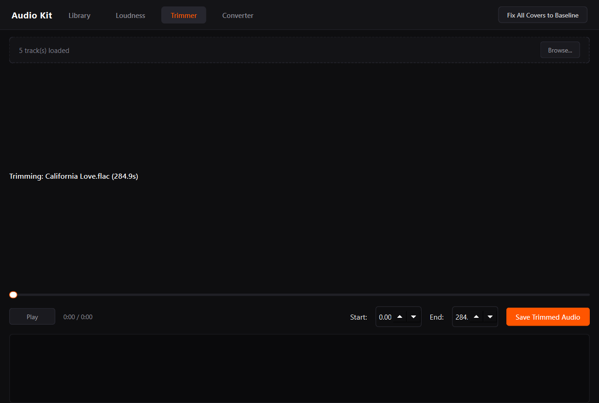
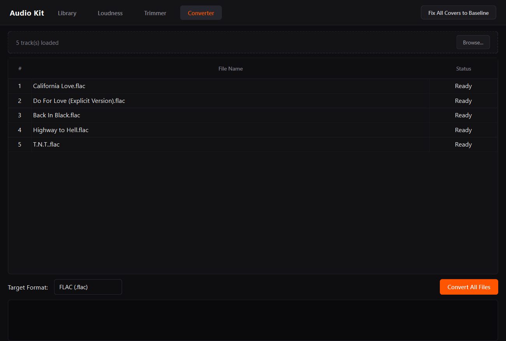

# Audio Kit

A lightweight, all-in-one desktop audio utility for metadata editing, Baseline JPEG cover encoding, EBU R128 loudness normalization, sample-accurate audio trimming, and batch format conversion.

---

## Screenshots

### 1. Library & Tag Editor

*Inline metadata editing and album cover management with one-click album inheritance.*

### 2. Audio Trimmer

*Sample-accurate audio slicing with integrated playback and scrubber controls.*

### 3. Format Converter

*Batch audio transcoding across FLAC, MP3, WAV, and OGG formats with metadata preservation.*

### 4. Loudness Normalizer (EBU R128)

*ITU-R BS.1770 / EBU R128 integrated loudness scanning (-18.00 LUFS target) and true peak tagging.*

---

## Features

- **Metadata Editor**: Edit standard tags (Title, Artist, Album, Track #, Year, Genre) across FLAC and MP3 files.
- **Hardware-Compliant Artwork**: Automatically converts progressive JPEGs and non-RGB covers into standard **Baseline RGB JPEG (Quality 95)** for digital audio players (DAPs) and legacy car stereos.
- **Dual-Source Cover Art**: Drop an image file or drop an existing audio track into the cover slot to extract artwork, then click `Apply to All` to tag an entire album.
- **Audio Trimmer**: Sample-accurate slicing with live playback controls, precise start/end spinboxes, and full metadata transfer.
- **Batch Converter**: Transcode audio collections to FLAC, MP3, WAV, or OGG while automatically migrating tags and cover artwork.
- **ReplayGain Normalizer**: Measures integrated loudness using ITU-R BS.1770 / EBU R128 algorithms and writes standard ReplayGain tags.

---

## Tech Stack

- **GUI & Media:** PyQt6, QtMultimedia
- **Audio DSP & Loudness:** Soundfile, pyloudnorm, NumPy
- **Metadata:** Mutagen
- **Image Processing:** Pillow

---

## Running

### Portable Binary
Run the executable directly:
```powershell
.\dist\AudioKit\AudioKit.exe
```

### From Source
```powershell
pip install PyQt6 mutagen pillow soundfile pyloudnorm numpy
python main.py
```

---

## License

[MIT License](LICENSE) — Liam Andreu Gamboa ([ye6isu](https://github.com/ye6isu))
