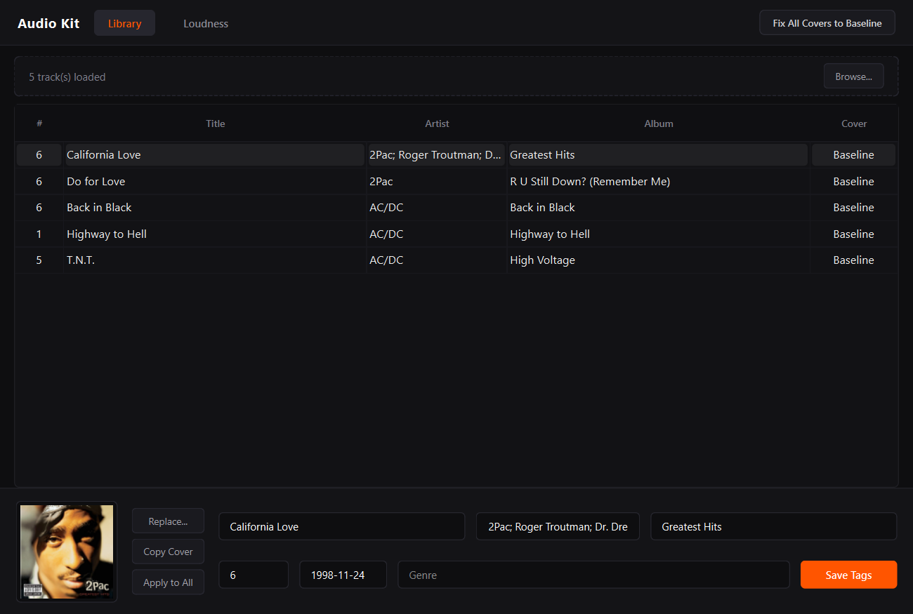
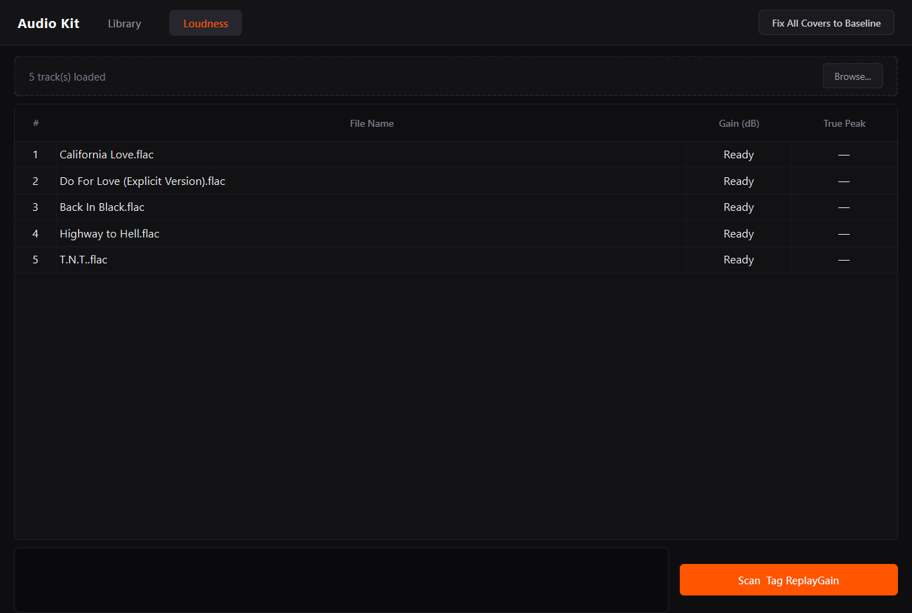

# Audio Kit

A lightweight desktop audio utility for metadata editing, Baseline JPEG cover encoding, and EBU R128 loudness normalization.

---

## Screenshots

### Library & Tag Editor

*Track list, inline metadata editing, and cover management with one-click album inheritance.*

### Loudness Normalizer (EBU R128)

*Integrated loudness scanning (-18.00 LUFS target) and true sample peak tagging.*

---

## Features

- **Metadata Editor**: Edit standard tags (Title, Artist, Album, Track, Year, Genre) across FLAC and MP3 files.
- **Hardware-Compliant Artwork**: Converts progressive JPEGs and non-RGB covers into standard **Baseline RGB JPEG (Quality 95)** for digital audio players and older hardware.
- **Dual-Source Cover Art**: Drop an image file or drop an existing audio track into the cover slot to extract artwork, then click `Apply to All` to tag an entire album.
- **Tag Deduplication**: Automatically cleans repeated multi-value artist and genre tags.
- **ReplayGain Normalizer**: Measures integrated loudness using ITU-R BS.1770 / EBU R128 algorithms and writes standard ReplayGain tags.

---

## Tech Stack

- **GUI**: PyQt6
- **Metadata**: Mutagen
- **Audio & Loudness**: Soundfile, pyloudnorm, NumPy
- **Image Processing**: Pillow

---

## Running

### Portable Binary
Run the executable directly:
```powershell
.\dist\AudioKit\AudioKit.exe
```

### From Source
```powershell
pip install PyQt6 mutagen pillow soundfile pyloudnorm numpy
python main.py
```

---

## License

[MIT License](LICENSE) — Liam Andreu Gamboa ([ye6isu](https://github.com/ye6isu))
